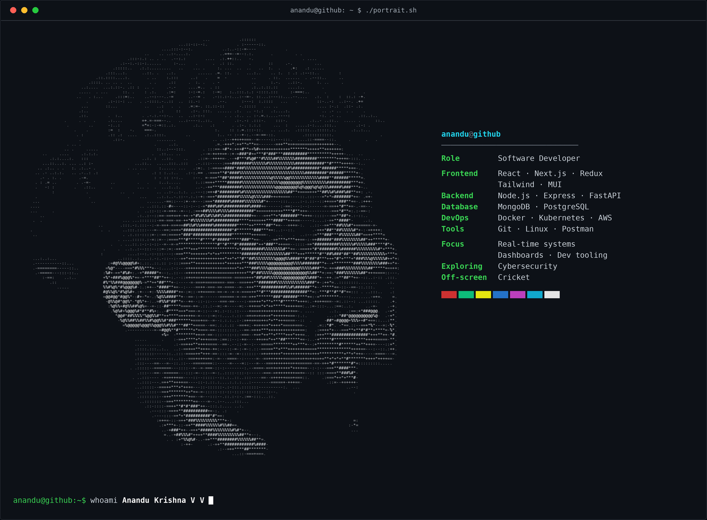

<div align="center">



<br/>

<a href="https://github.com/anandu-kris"></a>

<br/>

<a href="https://www.linkedin.com/in/anandu-krishna-v-v-1aa03b195/"></a>
<a href="https://twitter.com/anandu_kri_sh"></a>


</div>

<br/>

```text
anandu@github:~$ cat about.txt
```

```text
┌─ PROFILE ──────────────────────────────────────────────┐

  name        Anandu Krishna V V
  role        Software Developer
  builds      Dashboards, Full-stack platforms, Real-time systems
  exploring   Next.js, Kubernetes, Cybersecurity, AI
  ask me      WebSockets, Developer tooling, Scalable UI
  off screen  Playing cricket

└────────────────────────────────────────────────────────┘
```

> I turn complex ideas into clean, responsive products, from real-time interfaces to reliable backend systems. I care most about the point where thoughtful UX meets solid engineering.

<br/>

```text
anandu@github:~$ ps --active-missions
```

```text
  PID   STATUS    MISSION
  ───   ───────   ──────────────────────────────────────────
  001   [ RUN ]   Building responsive dashboards and real-time experiences
  002   [ RUN ]   Designing maintainable full-stack platforms
  003   [ LRN ]   Going deeper with Next.js and cloud-native architecture
  004   [ LRN ]   Learning practical cybersecurity fundamentals
```

<br/>

```text
anandu@github:~$ tree ~/stack
```

```text
~/stack
├── frontend/
│   └── React · Next.js · Redux · Tailwind CSS · Material UI
├── backend/
│   └── Node.js · Express · FastAPI
├── databases/
│   └── MongoDB · PostgreSQL
└── devops-tools/
    └── Docker · Kubernetes · AWS · Git · Linux · Postman
```

<div align="center">


</div>

<br/>

```text
anandu@github:~$ cat contact.txt
```

```text
╔════════════════════════════════════════════════════════╗
║                                                        ║
║   LET'S BUILD SOMETHING                                ║
║                                                        ║
║   Open to projects around dashboards, real-time        ║
║   systems, developer tooling and full-stack products.  ║
║                                                        ║
╚════════════════════════════════════════════════════════╝
```

<div align="center">

<a href="https://www.linkedin.com/in/anandu-krishna-v-v-1aa03b195/"></a>
<a href="https://twitter.com/anandu_kri_sh"></a>

<br/><br/>

```text
anandu@github:~$ echo "Code with intent. Ship with confidence. Keep exploring."
Code with intent. Ship with confidence. Keep exploring.
anandu@github:~$ _
```

</div>
